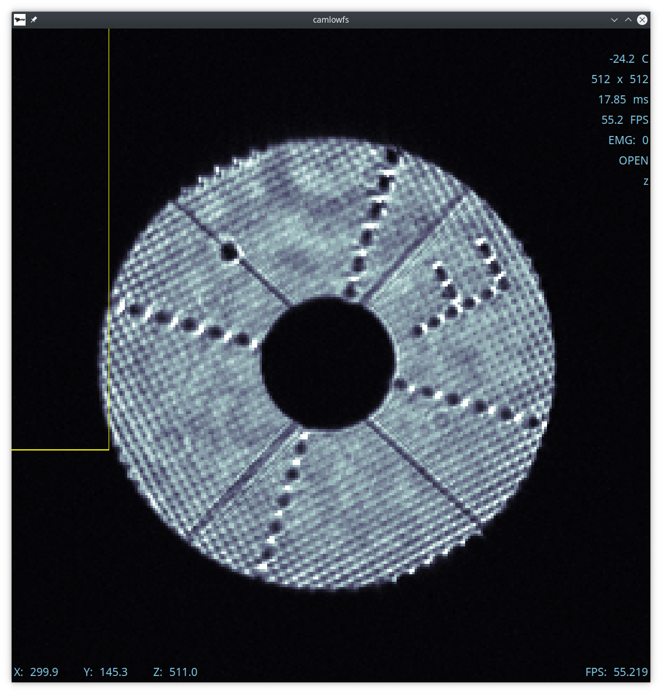
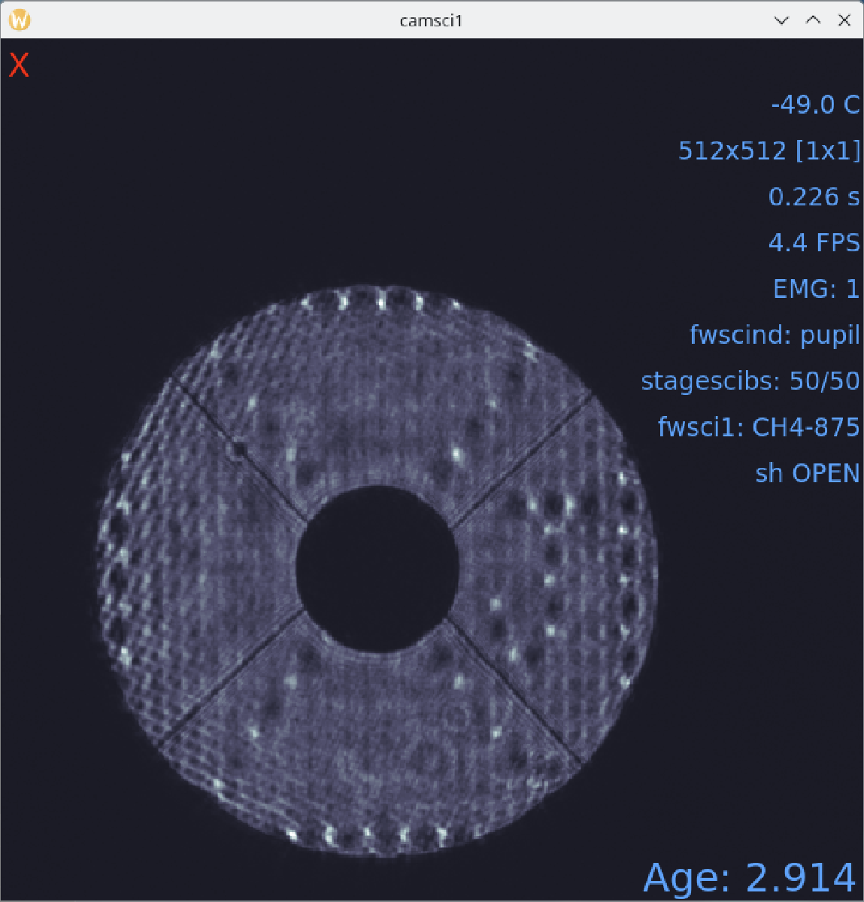
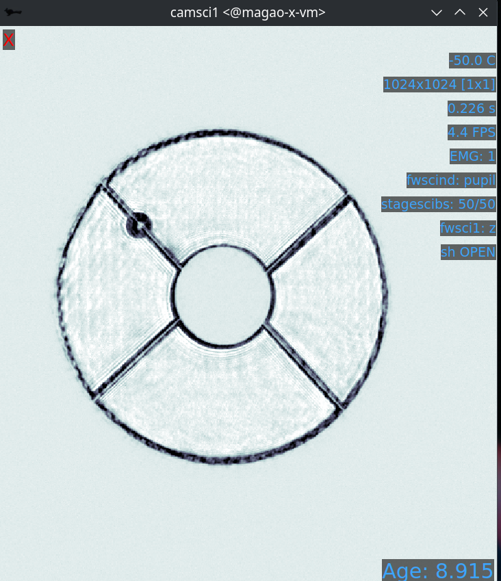

Alignment
===================================

These procedures assume that you have completed the :doc:`startup` and :doc:`daily_startup`. In other words, CACAO is configured, you have a PSF
on ``camtip``, and you are modulating.

System Pupil Alignment
-----------------------------------

This procedure will align the pupils on ``dmtweeter``, ``dmncpc``, and ``camwfs``. Things to remember:

    - ``ttmpupil`` is used to align the system pupil on ``dmtweeter``.  We use the actuators on ``dmtweeter`` as the reference (the F-Test).

    - `ttmpupil` moves the image of M1 in every pupil-plane inside MagAO-X, including `dmwoofer`, `dmtweeter`, on the modulator, `camwfs`, `fwpupil` (and the very nearby `dmncpc`), `fwlyot`, and as reimaged on `camsci1`.

    - We use `ttmperi` to align the pupil in the coronagraph using `dmncpc` actuators as a reference (the J-test).

    - However, `ttmperi` moves the pupil image for all of the lower bench.  Thus it is important to remember that you are also moving the pupil on `camwfs` with `ttmperi` during the J-Test, which can affect loop stability.

    - The *camera lens*, which consists of `stagecamlensx` and `stagecamlensy`, moves the pupils on camwfs.  The primary purpose of this is to register the `dmtweeter` actuators with the `camwfs` pixels.

    - However, **on-sky** we use the position of the `camwfs` pupils to control `ttmpupil` to keep the system pupil aligned as the *K-mirror* rotates.  This only works under the assumption that the actuators are aligned to the pixels first.

    - In **the lab** moving `ttmpupil` to fix `camwfs` pupil positions mis-registers the actuators w.r.t. the `camwfs` pixels. So the *Pupil Tracking Loop* must NOT be used in lab mode.


Alignment
~~~~~~~~~~~~~~~~~~~~~~~~~~~~

All of the alignment uses cameras downstream of the ``stagebs`` science/WFS beamsplitter, and changing beamsplitter causes shifts in both the pupil and focal plane.  Thus a change of beamsplitter will invalidate your alignment and require you to repeat these steps.


#. Decide whether you're using H-alpha / IR or 65-35 first, and configure ```stagebs```.

#. Setup modwfs ch1/ch2 voltages:

   a. 2000 Hz and 3 lambda/D modulation

   b. stagebs in 65-35: ch1 = 2V, ch2 = 6V

   c. stagebs in ha-ir: ch1 = 2.5V, ch2 = 7.5V

#. Use "move woofer" on pupilGuideGUI to align on tip and focus 

#. Now test to make sure that the HOloop is working properly by setting the HOloop gains to 0 and closing the loop.

     a. You should see a process appear in the CACAO ``milk-procCTRL`` window, titled ``mvalC2dm-1``. Ensure that the numbers under ``loopcnt`` (to the right of ``mvalC2dm-1``) are increasing.

     .. warning::
         If you do not see a ``mvalC2dm-1`` process appear or the numbers next to ``loopcnt`` are not increasing, stop and ask Jared (TODO: come up with troubleshooting solution for this step).

#. Close the loop on the first 24 modes, with offloading on for 20 modes or less.

   a. if it's unstable lower the modes to 10 or even 3, adjusting the offloading number of modes so that it's always equal or less.

#. "zero all" on woofer modes slider GUI.

#. While watching camwfs, start auto-alignment and allow it to converge. 

   a. if it stops itself with an error in the log:

      i. verify that you see the pokes on camwfs (ok to try again).  If not the tweeter is not responding.
      ii. if you do see pokes reconfigure camwfs and try again
      iii. if it still does not work ask for help.

   b. you do not need to increase number of HO modes in this step

   c. go on to the next step while alignment is running

#. Set up camflowfs

    a. fwpfm=knifemask
    b. stagelosel=fpm
    c. stageflowfs=fpm
    d. fwlowfs=z 
    e. ROI: 

       - For 65-35 use default 
       - For ha-ir set the ROI center to 1214,1427
    
    f. target cross on.
    g. camflowfs_avg to at least 2 seconds

#. Once the auto-alignment has converged stop it.
  
    a. at this step rough alignment (0.1 pixels) is fine

#. Open the loop and turn offloading off

#. Place ``stageff`` in "align" position for the beamsplitter
   
    a. in INDI toggle ``stageff.presetName.align-65-35`` or ``stageff.presetName.align-hair``

#. Run simulated turbulence (in cacao for now)

    a. adjust camflowfs exposure time so it is saturated (~100 FPS)

    .. image:: figures/camflowfS_alignment_target.png
       :width: 500
       :align: center

#. move picoscix until corner of alignment target spider is on target cross in x-direction as in the above picture.

	a. y doesn't matter

	b. use camflowfs_avg

    c. If you have already completed the alignment successfully, but are now switching beamsplitters: use the drop-down box to select the new beamsplitter.

    .. warning::

            Do **not** use the drop-down unless you are sure that you need to.  This is a relative move equivalent to hitting the arrow keys many times. It is not an absolute move to a setpoint. Do not use this to troubleshoot!

    d. If you do not see it on ``camflowfs`` after using the drop-down:

            1. ``camsci1`` has a wider FOV.  Make sure `fwscind` is not in `pupil`, move `fwfpm` to `open`, then use `camsci1` to find the spot.

            2. If you can see it on `camsci`, use `pico sci-x` to move the spot to roughly centered on `camsci1`, then return to `camflowfs`.

            3. If you do not see the spot on either `camflowfs` or `camsci1` then something is wrong.  Check all filter wheel and stage positions, ensure shutters are responding and open.

    e. On *Pupil Alignment Gui* use the `pico sci-x` buttons to move the PSF left and right to center on the target

        1. See above warning regarding using the drop-down selection for changing beamsplitters.

        2. Use the arrow buttons to move, changing the scale for finer control

        3. The PSF should be centered on the target along x in the `camflowfs` display

#. stop turbulence and zero

#. stageff to out

   a. in INDI toggle stageff.presetName.out
	
#. close the loop with offloading on
	
#. Then, select the ``move ttm`` option in the "Tip Alignment" section of the *Pupil Alignment GUI*

   a. adjust ``camflowfs`` exposre
   b. Use the arrow buttons under ``modttm`` to move the PSF such that the PSF is centered on the cross
   c. ensure that you don't go below 1 V or above 9 V under Modulation.

#. re-start auto-alignment.  

#. After the loop deltas have begun decreasing, close on all modes and set offloading to 20 modes.

#. Once the loops have converged ("Pupil Tracking Loop" and "Actuator Alignment Loop" deltas less than 0.05 in the lab) stop the :guilabel:`Auto Alignment` loop.

    a. In the lab the :guilabel:`Pupil Tracking Loop` should turn off when you stop the :guilabel:`Auto Alignment` loop.
    b. On sky the `Pupil Tracking Loop` should remain on when you stop the :guilabel:`Auto Alignment` loop.

#. Open the loop.

#. Move ``fwpm`` to open.

#. Align the beam on the NCPC DM using the :ref:`J-test <j-test>` and ``ttmperi``  (details below).

#. re-align the camwfs pupils using the camera lens x/y buttons.  Do NOT run auto-alignment again.

#. Now configure ``camwfs``:

    a. Put in `flipwfsf`
    b. Adjust `fwtelsim` and `camwfs` EM gain as needed to achieve at least 1-2000 counts on `camwfs`.
    c. you may need to reset protection

#. take a camwfs dark and then re-close the loop.

#. Conduct :ref:`FDPR <FDPR>` in the focal positions of interest and save the ncpc flats.


.. _f_test:

Manual Tweeter Pupil Alignment (F-Test)
~~~~~~~~~~~~~~~~~~~~~~~~~~~~~~~~~~~~~~~~

This does not need to be done if you have performed the :guilabel:`Auto Alignment`, however it is usually good to check it to make sure the automatic loop has converged properly.

.. note::
    If you modify the F-Test by actuating ``ttmpupil``, you will need to re-do both the J-Test and the ``camwfs`` pupil alignments.

To manually align the pupil on the tweeter, we perform the F-Test (which is now actually an R).

* **fwpupil** to **open** (in Coronagraph Alignment GUI)

* **fwfpm** to **open**

* **fwlyot** to **open**

* **fwscind** to **pupil** (in camsci1Ctrl)

* **fwsci1** to **z**

* configure **camsci1** so that you can see the pupil without saturating.

* Move **stagesci1** to preset **fpm**.

* If necessary, use the "Loop Zero" buttons to remove any leftover AO corrections.

Now put the test pattern on the tweeter with **Pupil Alignment GUI** for dmtweeter.  Press the **set test** under **Tweeter**

Next, use the "TTM Pupil" section to align the pupil on the tweeter using the arrow keypad.
The following figure demonstrates what a good alignment looks like.



When done, use the Tweeter **zero test** button on the Alignment GUI.

.. _j-test:

NCPC Pupil Alignment (J-Test)
~~~~~~~~~~~~~~~~~~~~~~~~~~~~~~~~~~~~

To align the pupil on `dmncpc`, we perform the J-Test.

.. note::
    ``ttmperi`` moves the pupil on the lower bench, including on ``camwfs``.
    This means adjusting the position on dmncpc with the AO loop closed can cause instability, even though dmncpc itself is downstream.

.. note::
    If aligning manually, follow the steps in :ref:`f_test` F-Test (above) first, as this changes the position downstream.
    The J-Test should only be performed after the F-Test is complete.

The system should be configured for the F-test above (in particular, check that ``fwscind`` is in ``pupil``). After completing the steps above,
:guilabel:`Auto Alignment` should be active and converged. Keep it active while you do this stage of the alignment.

Next,

* Move **stagesci1** to preset **test**.

* Put the test pattern on the ``dmncpcq`` with the :guilabel:`Set Test` button next to "NCPC" on the **Pupil Alignment GUI**.

Next, use the arrow buttons below :guilabel:`TTM Peri` to align the pupil on the NCPC DM.

After each move, wait a second or so for the Auto Alignment deltas to catch up.

.. warning:: As you are moving 'TTM Peri', monitor the CH1 [V] values just above the arrow buttons. If CH1 [V] reaches 150, then you have run out of range on TTM Peri. You will then need to offset the NCPC modal basis depending on the instrument's internal temperature. You can offset the basis by running either ``shiftncpc warm`` or ``shiftncpc cold`` on ``exao5``. Then, re-initialize ``dmncpc`` and re-set the flat. Now, verify that the numbers below CH1 [V] decrease when you click the "down" arrow button.

The following figure demonstrates what a good alignment looks like.



Once you are satisfied with the J-test alignment

* Clear the J-test with the "zero test" button on the **Pupil Alignment GUI**

* Return ``stagesci1`` to the ``fpm`` position

* Stop Auto Align and set offloading to 0 modes.

.. _fdpr:

Focus Diversity Phase Retrieval (FDPR)
------------------------------------------

To further improve PSF quality, run focus diversity phase retrieval (FDPR) to derive a new non-common-path correction DM shape. When setting up in labmode before observations, it is important to match the state of the instrument during FDPR to the state that the instrument will be in on-sky. This includes:

    - use `flipwfsf` and/or the ND filters on `fwtelsim` to simulate a target of similar magnitude to the one you will be observing. In             **cursesINDI**, you can navigate to `strehl` to see the estimated magnitude of the "star" you have created.

        - note: if your target is very faint, FDPR won't be able to produce a good result. If you see this behavior, you will have to simulate a brighter target.

    - determine whether you will perform FDPR in CH4 or Halpha. The default is to use CH4 unless you are doing Halpha observations.

        - If you choose CH4, you will use `camsci1` for FDPR.

        - If you choose Halpha, you will use `camsci2` for FDPR.

    - Make sure the instrument is in the correct WFS beamsplitter and science beamsplitter configuration for your observation. Then, move `stagesci1` or `stagesci2` to the correct focus position for those settings, as well as for the coronagraph you plan on using.

Once you have confirmed the instrument is in the right state for FDPR, run the algorithm by doing the following:

    #. Configure the filter wheel with the correct filter:

        - If using `camsci1`, set `fwsci1` with the narrow-band methane filter `CH4-875`

        - If using `camsci2`, set `fwsci2` to preset `Halpha` (**not** `Halpha-narrow`)

    #. Define a **ROI** centered on the core of the PSF

        - for `camsci1`, the ROI should be 369x369

        - for `camsci2`, the ROI should be 256x256

    #. If using a coronagraph, insert the coronagraph that you will be using now and move it out of the ROI (TODO: Include section for manual coronagraph alignment).

    #. Adjust `fwscind` and exposure time as needed to have plenty (25000--40000) of counts in the peak of the PSF.

    #. Close the shutter and take new darks. Then open the shutter.

    #. Open a terminal on ICC and run the FDPR process.

        - for `camsci1`: `fdpr2_close_loop fdpr2_dmncpc_camsci1_CH4`

        - for `camsci2`: `fdpr2_close_loop fdpr2_dmncpc_camsci2_Ha`

    #. On the lab source, the final strehl ratio should be close to 0.94. If the strehl is not quite there yet, you can run the process multiple times to improve it.

    #. Once the strehl is satisfactory, save the flat with `dm_save_flat ncpc -d fdpr`.

    .. note::
        If setting up FDPR for a particular coronagraph configuration, you will want to name your DM flat accordingly (ie. `dm_save_flat ncpc -d fdpr_lyotlg` if using LyotLG).

    #. On the `dmncpc` control GUI, zero all channels. Then, select the new flat from the drop-down menu and apply it.

.. _coronAlign:

Focal Plane and Coronagraph Alignment
-------------------------------------

Automated Bump Mask and Lyot Stop Alignment
~~~~~~~~~~~~~~~~~~~~~~~~~~~~~~~~~~~~~~~~~~~
Put ``fwscind`` into **pupil** mode. Then, from the **Coronagraph Alignment GUI**, change **fwpupil** to **bump-mask**. Make sure that ``camsci1`` is in the :guilabel:`full` ROI and that ``stagesci1`` is at position 54.5.

Then, in **cursesINDI**, navigate to **pupilCorAlign** and toggle **pupilCorAlign.state.centroid** ON. A pattern should appear on ``dmncpc``. Then, toggle **pupilCorAlign.state.fwpupil** ON. You should see the properties **fwpupil.dx** and **fwpupil.dy** start to change. Wait for these numbers to converge to a magnitude less than about 0.2, then toggle **pupilCorAlign.state.idle** ON to stop the process. The bump mask should now be aligned.

.. note::
    The pattern on ``dmncpc`` sometimes freezes, and the app stops working. To fix this, go to a terminal on ``icc`` and, as ``xsup``, do         ``xctrl restart pupilCorAlign``, and that should fix things. You do **not** have to redo the centroid step after the restart.

Now, use the **Coronagraph Alignment GUI** to put ``fwlyot`` into your desired Lyot stop, usually **LyotLg1**. Toggle **pupilCorAlign.state.fwlyot** to ON and watch the values under **fwlyot.dx** and **fwlyot.dy**. Once they converge to a magnitude <0.2, toggle **pupilCorAlign.state.idle** ON to stop the process. The Lyot stop should now be aligned.


Manual Bump-Mask Alignment
~~~~~~~~~~~~~~~~~~~~~~~~~~

From the **camsci1** gui, set

    * **fwscind** to **pupil**
    * **stagesci1** to **telsim**

With the camsci1 shutter **open**, take a new dark. This will serve as the reference for alignment.

In the coronagraph alignment GUI: set **fwpupil** to **bump-mask**.

The camsci1 viewer will show the difference image, making it easier to align with the (now obscured) spider arms of the pupil.

Use the "Pupil Plane" directional buttons on the coronagraph alignment GUI to align the mask to the pupil.



Once the bump mask is aligned, change **fwscind** back to whatever you had before switching to pupil imaging mode.

Remember to close the shutter on camsci1 and **take a new dark**.


Manual Lyot Stop Alignment
~~~~~~~~~~~~~~~~~~~~~~~~~~

From the **camsci1** gui, set

    * **fwscind** to **pupil**
    * **stagesci1** to **telsim**

With the camsci1 shutter **open**, take a new dark. This will serve as the reference for alignment.

In the coronagraph alignment GUI: set **fwpupil** to **lyotlg** or **lyotsm** (this will depend on your choice of coronagraph).

The camsci1 viewer will show the difference image, making it easier to align with the (now obscured) spider arms of the pupil.

Use the "Lyot Plane" directional buttons on the coronagraph alignment GUI to align the mask to the pupil.

TODO: Update the below figure:


Once the Lyot Stop is aligned, change **fwscind** back to whatever you had before switching to pupil imaging mode.

Remember to close the shutter on camsci1 and **take a new dark**.

.. include:: piaa_alignment.rst
