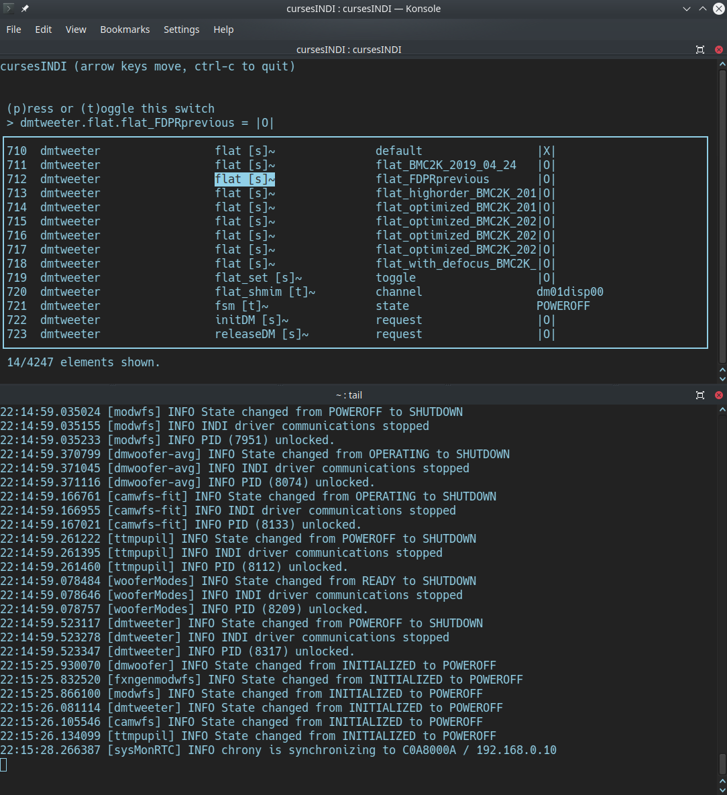

cursesINDI
==========

The instrument interface of first and last resort.

The ``cursesINDI`` tool is available on all MagAO-X computers (including
VMs and the test bed) and enables viewing and manipulation of the
instrument settings via low-level properties and the INDI protocol. It
can be useful when adding new drivers to the system, or when trying to
track down a strange behavior in a higher-level GUI interface.

You do not need to be ``xsup`` to run ``cursesINDI``, but you do need
``localhost:7624`` to connect to a local or remote indiserver. This is
the case when SSHed in to AOC, RTC, ICC, or the testbed (TCC);
otherwise, you can use SSH tunneling.

Overview
--------

Start cursesINDI from a terminal with the ``cursesINDI`` command.

   screenshot of a terminal showing cursesINDI in action

The terminal will blank and show something like the top pane in the
screenshot above. Note: that you may need to resize your terminal to see
all five columns:

-  index
-  device name
-  property name (and meta info, see below)
-  element name (see conventions below)
-  value

By default, typing in the device column searches for a matching row
without hiding other rows. Use the arrow keys to move between rows and
columns.

Right-arrow over to the value column, and the ``search:`` prompt will
change to ``(e)dit this number``. Hit the ``e`` key and you’ll be
prompted to ``set devname.propname.element=``. Type in your new value,
hit ``enter``, and confirm (after checking carefully) the new value with
``y``. (Or, you can hit ``Esc`` to get out of setting the value.)

Note that many properties are read-only, and you will not be offered to
edit them if so.

``cursesINDI`` also shows you the current value of the element you have
selected as ``set devname.propname.element = <value>``. Text and numbers
are displayed as transmitted by INDI. Switches use ``|O|`` for off and
``|X|`` for on.

Search and navigation
---------------------

Search is case-insensitive and supports fuzzy matching within each field
of ``device.property.element``. For example, ``cwfs.exp.cur`` matches
``camwfs.exposure.current``. Periods separate fields; an empty field is a
wildcard, so ``.exposure`` searches properties on any device. Exact matches
rank first, and query fields of four or more characters tolerate one typo.

- ``Ctrl+L`` clears the query, exits filtering, and focuses search without
  changing the selected row until you type.
- ``Ctrl+F`` filters the table to matching rows, with the best matches first.
  Entering filter mode clears the search query; pressing it again preserves
  the current filter for editing.
- While typing, ``Ctrl+Backspace`` deletes back to the previous period:
  ``camwfs.exposure.current`` becomes ``camwfs.exposure.``, then ``camwfs.``,
  then empty. This uses the terminal's ``Ctrl+H`` code, so ``Ctrl+H`` also
  works; a terminal with a different mapping may need configuration.

``Ctrl+V`` toggles optional VI navigation, which is off by default. When
on, the header shows ``VI on`` and ``cursesVINDI`` with ``VI`` highlighted.
Use ``h/j/k/l`` to move left/down/up/right, prefix a movement with a count
(e.g. ``12j`` moves down 12 rows), or use ``Ctrl+U`` / ``Ctrl+D`` to move
up/down half the visible table height. Movements stop at the table edges.
Use ``Ctrl+L`` or ``Ctrl+F`` to type a query in VI mode; ``Enter`` returns
to navigation without clearing the query or filter.

The normal table sorts by device, property, then element. The selected
element stays selected when other properties are added or removed.

Property meta info
------------------

The bracketed letter indicates whether a property is a ``[t]ext``,
``[n]umber``, ``[s]witch``, or ``[l]ight`` as defined by INDI. The
character after the brackets can be ``~`` (Idle), ``-`` (Ok), ``*``
(Busy), or ``!`` (Alert). You’ll see Idle properties switch to Busy when
you set them, and back to Idle once the state you’ve set has been
reached.

Element naming convention
-------------------------

In the MagAO-X instrument, the convention is for settable properties to
expose their ``current`` value and their ``target`` value as two
elements of the property. This is useful to, e.g., command stages and
compare their current location to their commanded one. (Thanks to
limitations in INDI, “read-only” can only apply to properties, not
elements. Functionally, ``current`` is read-only and all edits are to
``target``.)

Process Logs
------------

All process logs for INDI-connected MagAO-X applications are streamed to
INDI clients. ``cursesINDI`` writes these as they are received to the
file ``/tmp/cursesINDI_logs.txt``. You can monitor these logs in
real-time with the command

::

   $ tail -f /tmp/cursesINDI_logs.txt

The result is shown in the bottom pane of the above screenshot. Most
terminal programs allow you to split the screen, making for a nice
combined system control panel with the logs on the bottom. The image
above shows this.

The ``cursesINDI`` log file will only contain up to 1000 entries, at
which point is emptied and restarted. For more detailed inspection of a
processes history you must use the ``logdump`` utility.
